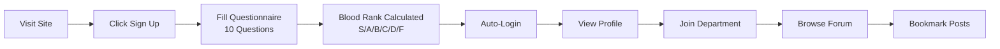
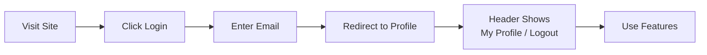

# 🐉 Night Watcher Forum — Dragon Raja Fan Community

> A full-stack web application demo inspired by the *Dragon Raja* novel series, featuring user authentication, dynamic content, and real-time database operations.

## 📖 Table of Contents

- [Overview](#-overview)
- [Quick Start](#-quick-start)
- [System Architecture](#-system-architecture)
- [User Workflow](#-user-workflow)
- [Tech Stack](#-tech-stack)
- [Project Structure](#-project-structure)
- [Pages & Features](#-pages--features)
- [API Documentation](#-api-documentation)
- [Database Schema](#-database-schema)
- [Development Guide](#-development-guide)
- [Troubleshooting](#-troubleshooting)

---

## 🌟 Overview

**Night Watcher Forum** is a complete full-stack web application that recreates the fantasy world of Cassell College from the Dragon Raja universe. The website recreates the world of Cassell College through role-play design and modern UI~

This immersive fan community website allows users to:

Join role-play discussions as Cassell College agents
Share creative fan works and artwork
Take the "First Blood Lineage Investigation" admission exam
Connect with fellow Dragon Raja fans
Experience magical animations and fantasy-themed design

And more: 

- 🔐 **User Authentication** — Email-based login/signup with session management
- 🩸 **Blood Rank System** — Unique ranking algorithm (S/A/B/C/D/F) based on questionnaire responses
- 📝 **Dynamic Forum** — Database-driven posts with pagination, sorting, and bookmarking
- 🎨 **Fan Works Gallery** — Dynamic content loaded from MongoDB
- 🏛️ **Department Affiliation** — Users can join one of 5 Cassell College departments
- 💾 **Real-time Database** — All user actions persist to MongoDB

### What Users Can Do

| Feature | Description |
|---------|-------------|
| **Sign Up** | Complete the "Blood Lineage Investigation" questionnaire to receive a blood rank |
| **Login** | Access your profile using registered email |
| **Browse Forum** | View discussion posts with sorting (Recent/Character) and pagination |
| **Bookmark Posts** | Save posts to your profile for later |
| **Join Department** | Affiliate with Student Council, Lionheart Society, Execution Dept, News Club, or Equipment Division |
| **View Profile** | See blood rank, scores, department, and bookmarked posts |

---

## 🚀 Quick Start

### Prerequisites

- **Node.js** v18+ — [Download](https://nodejs.org/)
- **MongoDB** v6+ — [Download](https://www.mongodb.com/try/download/community)

### 5-Minute Setup

```bash
# 1. Navigate to project
cd HW4

# 2. Install dependencies
npm install

# 3. Start MongoDB (in separate terminal)
# macOS:
brew services start mongodb-community
# Windows: Start MongoDB from Services
# Linux:
sudo systemctl start mongod

# 4. Seed the database (first time only)
npm run seed

# 5. Start the server
npm run dev

# 6. Open browser
# → http://localhost:3002
```

### Test Login

After seeding, try logging in with any of these pre-created accounts:

| Email | Blood Rank | Department |
|-------|------------|------------|
| `caesar@cassell.edu` | A-Rank | Student Council |
| `johann@cassell.edu` | A-Rank | Lionheart Society |
| `ricardo@cassell.edu` | F-Rank | Not affiliated |
| `erii@cassell.edu` | S-Rank | Not affiliated |

---

## 🏗️ System Architecture

### High-Level Overview

```
┌─────────────────────────────────────────────────────────────────┐
│                        CLIENT BROWSER                           │
│  ┌──────────────────────────────────────────────────────────┐   │
│  │  HTML Pages (index, forum, fanworks, login, profile...)  │   │
│  │  ├── styles.css (UI styling)                             │   │
│  │  ├── script.js (DOM manipulation, API calls)             │   │
│  │  └── auth.js (authentication, user session)              │   │
│  └──────────────────────────────────────────────────────────┘   │
└─────────────────────────┬───────────────────────────────────────┘
                          │ HTTP Requests (fetch API)
                          ▼
┌─────────────────────────────────────────────────────────────────┐
│                    EXPRESS SERVER (app.js)                      │
│                        Port: 3002                               │
│  ┌──────────────────────────────────────────────────────────┐   │
│  │  Middleware: CORS, JSON parsing, Static file serving     │   │
│  ├──────────────────────────────────────────────────────────┤   │
│  │  Routes:                                                  │   │
│  │  ├── /api/articles    → Content endpoints                │   │
│  │  ├── /api/fanworks    → Fan works endpoints              │   │
│  │  ├── /api/forum/*     → Forum CRUD operations            │   │
│  │  ├── /api/auth/*      → Authentication                   │   │
│  │  └── /api/contact     → Form submissions                 │   │
│  └──────────────────────────────────────────────────────────┘   │
└─────────────────────────┬───────────────────────────────────────┘
                          │ MongoDB Driver
                          ▼
┌─────────────────────────────────────────────────────────────────┐
│                    MONGODB DATABASE                             │
│                 nightwatcher_forum (localhost:27017)            │
│  ┌──────────────────────────────────────────────────────────┐   │
│  │  Collections:                                             │   │
│  │  ├── users (10 sample)      ├── forum_posts (25)         │   │
│  │  ├── articles (100)         ├── post_replies             │   │
│  │  ├── fanworks (50)          ├── user_bookmarks           │   │
│  │  ├── departments (5)        ├── questionnaire_submissions│   │
│  │  └── contact_submissions                                  │   │
│  └──────────────────────────────────────────────────────────┘   │
└─────────────────────────────────────────────────────────────────┘
```

### Data Flow

```
User Action → Frontend JS → fetch() API → Express Route → MongoDB Query → Response → DOM Update
```

### Session Management

```javascript
// Client-side (localStorage)
localStorage.setItem('cassell_user', JSON.stringify(user));  // Login
localStorage.getItem('cassell_user');                        // Check session
localStorage.removeItem('cassell_user');                     // Logout

// All data operations go through API → MongoDB (real-time)
```

---

## 👤 User Workflow

### New User Journey



### Returning User Journey



### Blood Rank Algorithm

The system evaluates questionnaire responses:

| Component | Weight | Scoring |
|-----------|--------|---------|
| Multiple Choice (Q1-Q6) | 40% | Fantasy/loneliness answers = 10pts, Neutral = 5pts, Realistic = 0pts |
| Text Questions (Q7-Q10) | 60% | ≥800 words = 10pts, 500-799 = 8pts, 200-499 = 6pts, 50-199 = 4pts |

**Rank Thresholds:**
- **S-Rank** (90-100) 👑 Supreme Dragon Blood
- **A-Rank** (80-89) ⭐ Superior Dragon Blood
- **B-Rank** (70-79) 🔱 Above Average
- **C-Rank** (60-69) ⚔️ Competent
- **D-Rank** (50-59) 🌱 Developing
- **F-Rank** (0-49) 🔮 Dormant

---

## 🛠️ Tech Stack

### Frontend
| Technology | Purpose |
|------------|---------|
| HTML5 | Semantic structure |
| CSS3 | Flexbox, Grid, animations, responsive design |
| Vanilla JavaScript | DOM manipulation, fetch API, session management |
| Cinzel + Open Sans | Fantasy-themed typography |

### Backend
| Technology | Purpose |
|------------|---------|
| Node.js v18+ | JavaScript runtime |
| Express.js 4.18 | Web framework, routing, middleware |
| MongoDB 6+ | NoSQL database |
| dotenv | Environment configuration |

### Development
| Tool | Purpose |
|------|---------|
| nodemon | Auto-restart on file changes |
| npm | Package management |

---

## 📁 Project Structure

```
HW4/
│
├── 📂 public/                    # Static assets (served by Express)
│   ├── index.html                # Homepage - dynamic articles from DB
│   ├── forum.html                # Forum - posts, sorting, pagination
│   ├── forumDiscussion.html      # Thread creation, my posts, bookmarks
│   ├── fanworks.html             # Fan works gallery
│   ├── contact.html              # Contact form
│   ├── questionnaire.html        # Sign up / Blood rank exam
│   ├── login.html                # User login
│   ├── profile.html              # User profile & bookmarks
│   ├── success.html              # Admission confirmation
│   ├── styles.css                # Global stylesheet
│   ├── script.js                 # Main client JS (API calls, DOM)
│   └── auth.js                   # Authentication logic
│
├── 📂 db/                        # Database layer
│   ├── connection.js             # MongoDB connection & initialization
│   ├── auth.js                   # Blood rank calculation logic
│   └── seed.js                   # Database seeding script (240 docs)
│
├── 📂 routes/                    # API routes
│   ├── api.js                    # Content, forum, contact endpoints
│   └── auth.js                   # Authentication endpoints
│
├── app.js                        # Express server entry point
├── package.json                  # Dependencies & scripts
├── .env                          # Environment variables (not committed)
├── .env.example                  # Environment template
├── .gitignore                    # Git ignore rules
├── README.md                     # This file
├── hw4-update-plan.md            # Development plan & documentation
└── SETUP_INSTRUCTIONS.md         # Quick setup guide
```

---

## 🧩 Pages & Features

### 1. Homepage (`index.html`)
- Hero banner with search
- **Dynamic content**: Latest Articles, Hot Topics, Featured Fan Works (from MongoDB)
- Call-to-action for admission questionnaire
- Responsive 3-column grid

### 2. Forum (`forum.html`)
- **Department Sidebar**: 5 departments with member counts, join buttons
- **Dynamic Posts**: Loaded from `forum_posts` collection
- **Sorting**: Recent (newest first) | Character (alphabetical by author)
- **Pagination**: 10 posts per page with Previous/Next/Page numbers
- **Actions**: Reply, Bookmark, Share buttons
- **Quick Actions**: Start New Thread, View My Posts, Bookmarked

### 3. Forum Discussion (`forumDiscussion.html`)
- **Start New Thread**: Title + content (max 2000 words) + word counter
- **My Posts**: All posts by logged-in user
- **My Bookmarks**: All bookmarked posts

### 4. Fan Works Gallery (`fanworks.html`)
- **Dynamic Gallery**: Top 12 works from MongoDB
- **Sorting**: Most Popular (by comments) | Most Liked (by likes)
- Responsive 4-column grid

### 5. Login (`login.html`)
- Email-based authentication
- Links to signup (questionnaire)

### 6. Profile (`profile.html`)
- Blood rank badge with score breakdown
- Department affiliation
- Bookmarked posts section
- Logout functionality

### 7. Questionnaire (`questionnaire.html`)
- 10-question "Blood Lineage Investigation"
- Name + email fields
- Calculates blood rank on submission
- Auto-login after signup

### 8. Contact (`contact.html`)
- Contact form with topic dropdown
- Submissions saved to MongoDB

---

## 🔌 API Documentation

### Base URL
```
http://localhost:3002/api
```

### Content Endpoints

| Method | Endpoint | Description |
|--------|----------|-------------|
| GET | `/articles` | Get all articles (optional: `?category=latest\|hot\|featured`) |
| GET | `/articles/:id` | Get single article |
| GET | `/fanworks` | Get fan works (optional: `?sort=popular\|liked&limit=12`) |
| GET | `/departments` | Get all departments |

### Authentication Endpoints

| Method | Endpoint | Description |
|--------|----------|-------------|
| POST | `/auth/signup` | Create user with questionnaire answers |
| POST | `/auth/login` | Login by email |
| GET | `/auth/profile/:userId` | Get user profile |
| PUT | `/auth/department` | Join a department |
| GET | `/auth/check-email` | Check if email exists |

### Forum Endpoints

| Method | Endpoint | Description |
|--------|----------|-------------|
| GET | `/forum/posts` | Get posts (`?sort=recent\|author&page=1&limit=10`) |
| POST | `/forum/create` | Create new thread |
| POST | `/forum/bookmark` | Bookmark a post |
| GET | `/forum/bookmarks/:userId` | Get user's bookmarks |
| GET | `/forum/posts/user/:userId` | Get user's posts |

### Form Endpoints

| Method | Endpoint | Description |
|--------|----------|-------------|
| POST | `/questionnaire/submit` | Submit questionnaire |
| POST | `/contact/submit` | Submit contact form |

---

## 🗄️ Database Schema

### Database: `nightwatcher_forum`

#### Collections Overview

| Collection | Documents | Description |
|------------|-----------|-------------|
| `users` | 10 | Registered users with blood ranks |
| `articles` | 100 | Homepage content (latest/hot/featured) |
| `fanworks` | 50 | Fan art, fiction, cosplay |
| `departments` | 5 | Cassell College departments |
| `forum_posts` | 25 | Discussion threads |
| `post_replies` | 0* | User replies |
| `user_bookmarks` | 0* | Saved posts |
| `questionnaire_submissions` | 30 | Sign-up submissions |
| `contact_submissions` | 20 | Contact form entries |

*User-generated content

#### Key Schemas

```javascript
// users
{
  _id: ObjectId,
  name: String,
  email: String (unique),
  bloodRank: "S" | "A" | "B" | "C" | "D" | "F",
  bloodRankScore: Number (0-100),
  bloodRankBreakdown: { mcScore, textScore, avgWordCount },
  affiliatedDepartment: String | null,
  createdAt: Date,
  lastLogin: Date
}

// forum_posts
{
  _id: ObjectId,
  title: String,
  content: String,
  author: String,
  authorId: ObjectId,
  department: String,
  replies: Number,
  views: Number,
  createdAt: Date
}

// user_bookmarks
{
  _id: ObjectId,
  userId: ObjectId,
  postId: ObjectId,
  bookmarkedAt: Date
}
// Unique index on (userId, postId)
```

---

## 🔧 Development Guide

### Available Scripts

```bash
npm start        # Start production server
npm run dev      # Start with auto-reload (nodemon)
npm run seed     # Populate database with sample data
```

### Environment Variables

Create `.env` from `.env.example`:

```env
PORT=3002
NODE_ENV=development
MONGODB_URI=mongodb://localhost:27017
DB_NAME=nightwatcher_forum
```

### Adding New Features

1. **New API Endpoint**: Add route in `routes/api.js` or `routes/auth.js`
2. **New Page**: Create HTML in `public/`, add script imports
3. **Database Changes**: Update `db/connection.js` for new collections
4. **Frontend Logic**: Add to `script.js` (general) or `auth.js` (auth-related)

### Code Style

- Use `async/await` for API calls
- Handle errors with try/catch
- Log with console prefixes: `🔐`, `📬`, `✅`, `❌`
- Use `fetchAPI()` utility for consistent error handling

---

## 🚨 Troubleshooting

### Common Issues

| Problem | Solution |
|---------|----------|
| **Port 3002 in use** | `lsof -ti:3002 \| xargs kill` or change PORT in `.env` |
| **Cannot connect to MongoDB** | Start MongoDB: `brew services start mongodb-community` |
| **Module not found** | Run `npm install` |
| **Empty homepage** | Run `npm run seed` to populate database |
| **Login not working** | Hard refresh browser (Cmd+Shift+R) to clear JS cache |
| **API 404 errors** | Check server is running, verify `/api` prefix in calls |

### Debug Tips

1. **Check browser console** (F12) for JavaScript errors
2. **Check Network tab** to verify API calls
3. **Check terminal** for server-side errors
4. **Verify MongoDB**: Run `mongosh` and `show dbs`

---

## 📊 Project Statistics

| Metric | Count |
|--------|-------|
| HTML Pages | 9 |
| JavaScript Files | 2 (client-side) |
| API Endpoints | 15+ |
| Database Collections | 9 |
| Seeded Documents | 240 |
| Lines of Code | ~5000+ |

---

## 🎨 Design Theme

### Color Palette
- **Deep Emerald** `#1C3D35` — Primary
- **Accent Gold** `#D4AF37` — Highlights
- **Off-White** `#F8F8F2` — Background
- **Silver** `#C0C0C0` — Secondary

### Typography
- **Headings**: Cinzel (serif, fantasy-themed)
- **Body**: Open Sans (sans-serif, readable)

---

## 📝 Changelog

### December 2025
- ✅ Full-stack migration from static prototype
- ✅ MongoDB integration with 240 seeded documents
- ✅ User authentication with blood rank system
- ✅ Dynamic forum with pagination and bookmarking
- ✅ Fan works gallery with sorting
- ✅ Multiple bug fixes and UI improvements

---

## 📄 License

MIT License — Feel free to use for educational purposes.

---

**Welcome to the Night Watcher Forum!** 🐉

*"In every ordinary heart lies the courage of dragons."*

---

*Course: APAN 5490 AI User Interface UI/UX Design*  
*Assignment 4 — Full-Stack Web Application*  
*Author: Steven Huo*  
*Date: December 2025*
